<!-- Cards are generated by scripts/render_cards.py and refreshed daily by .github/workflows/profile-cards.yml.
     Each SVG follows the viewer's OS/browser light or dark setting on its own. -->

